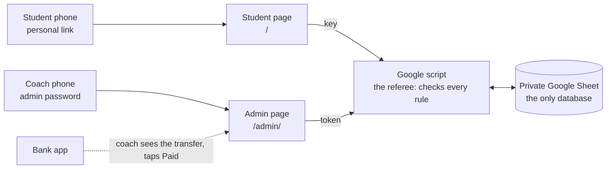
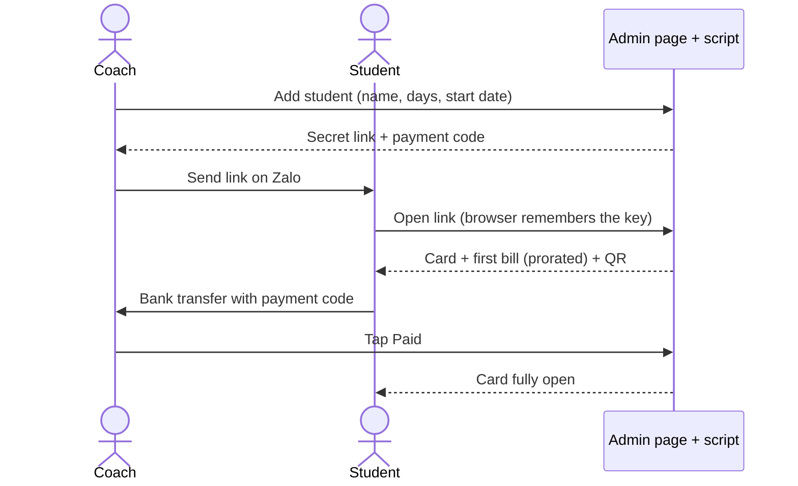
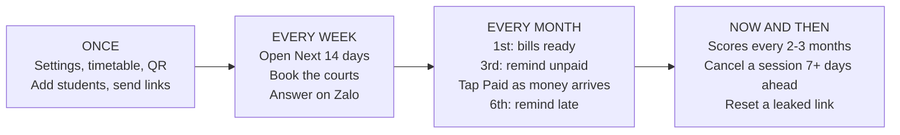
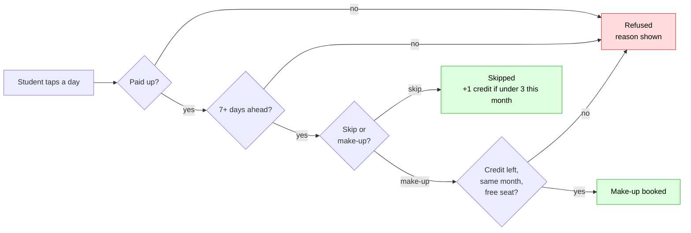
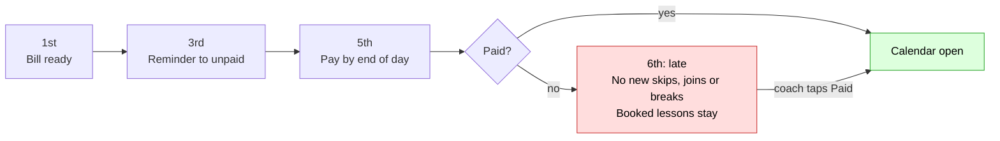

# Birdie Crew: badminton coaching site

Site address: `birdiecrew.github.io` (GitHub Pages, free).

## At a glance
Five pictures. Everything after them is detail.

**1. The parts.** Two pages, one referee, one private Sheet.

**2. A new student joins.**

**3. The coach's routine.**

**4. A student skips or takes a make-up.** The script runs these checks on every tap.

**5. One month of money.**

## The idea in one line
A free website with two doors on the same address: each student opens **their own card** (schedule, skill polygon, bills, videos), and the coach runs the class from a **password-protected admin page**. A private Google Sheet is the database behind both.

## What we copied from Project Snowball
Snowball has no payment company. People scan a QR code, put a short code in the transfer note, and the owner checks the bank app, then marks it in a Google Sheet. We reuse this as is: no accounts, no card fees.

Two differences. Snowball's list of codes is public, but student scores are personal and some students may be kids, so here the Sheet stays **private** and a small Google script hands each student only their own data. And Snowball uses one code for everything; here the code in the bank transfer is **not** the secret that opens the student card (see "Access and privacy").

## How it works
- **Website:** plain static pages on GitHub Pages. No server. Two pages: the **student page** (`/`) and the **coach admin page** (`/admin/`).
- **Brain:** a private Google Sheet in the same new account, plus a Google Apps Script web app that is the only thing that reads or writes it.
- **Student access:** a personal link with a secret key in it. They open it once and the browser remembers it.
- **Coach access:** the admin page, protected by an admin password that the script checks.
- **The script is the referee.** The pages only display things. Every rule below is checked again inside the script, so nobody can get around a rule by editing the page.

## The class rules (from the coach's own notice)
These are the real rules of the class. The site must follow them, and every number is a setting the coach can change.

1. **Fee:** paid at the start of each month, **deadline the 5th**.
2. **Timetable:** Monday to Thursday **20:00 to 22:00**. Saturday and Sunday **10:00 to 12:00**. No class on Friday.
3. **Flexible members:** students without a fixed schedule send their planned schedule **the week before**, so the coach can arrange the class and time slots.
4. **Breaks:** for a planned break (for example 2 weeks to 1 month), tell the coach **in advance**, so the coach can arrange the class and **adjust the fee**.
5. **Make-up lessons:** because the class is big, at most **3 make-up lessons per month per person**.
6. **Sudden absence:** if a student reports an absence at the last minute, **no make-up** is arranged.

## How lessons work

### The timetable
The weekly timetable lives in a Timetable tab (weekday, start, end), so nobody has to create lessons one by one. The Sheet only needs a row when something is special: a cancelled day, a day with fewer courts, or extra seats (the "Session overrides" tab).

### Seats and courts (demand-driven)
The venue has **4 courts** and the coach books courts after she knows who is coming. So seats are not fixed by a courts number. Instead:
- A session holds up to **`venue_courts` x `seats_per_court` = 4 x 4 = 16 seats**. The coach can allow 0 to 2 **extra seats** on a session for a squeeze-in.
- The site tells the coach **how many courts to book**: headcount divided by 4, rounded up. It shows this for every session in the admin page.
- Because changes lock `advance_days` (7) before a lesson, a session's headcount is mostly settled a week ahead. That is when the coach can book courts.
- Regular students are never bumped. If the coach adds people and a session goes over its seats, it shows as "over capacity" for her and as full for make-ups and flexible joins.
- A student skipping or on a break frees a seat for someone else.
- Capacity check: 16 seats x 6 sessions a week is 96 seat-slots a week at most. So about 48 students attending twice a week is the real ceiling. 100 students is only an upper bound for the data size.

### Two kinds of student
- **Fixed schedule** (most students). The coach sets their days (for example Tuesday and Thursday). They are booked every week with no action. Their only actions: **skip** a lesson, and **pick a make-up**.
- **Flexible schedule.** No fixed days. They pick the sessions they plan to attend, at least `flex_notice_days` before each one. This is the site version of "send me your plan the week before". Seats apply. They have no make-up credits, because there is no fixed lesson to make up.

### Skip and make-up (fixed students), step by step
- Telling the coach **in advance** (at least `advance_days` before the lesson) lets a student skip. A skip earns **1 make-up credit**.
- A student can earn and use at most **`max_makeups_per_month` make-ups per calendar month** (default 3). A skip beyond that is still allowed, but earns no credit.
- The credit must be used on a session **in the same calendar month as the skipped lesson**. Unused credit expires at the end of that month.
- The make-up can be on any session that month with a free seat (before or after the skipped lesson), as long as it follows the rules below.
- **Sudden absence = no make-up.** If a student does not show up, or tries to skip inside the notice window, the lesson counts as attended and nothing is owed. The site locks the button, so the coach never has to argue about it.
- All of this is **self-service and instant**. No coach approval. The coach sees every skip and make-up in the admin page.
- **Changing their mind:** a student can **undo a skip** ("I will attend after all") up to the same `advance_days` cutoff as skipping. Their seat comes back, the credit goes away, and a later skip that got no credit (because of the cap of 3) takes the freed one. If that credit was already used for a make-up, the student must cancel the make-up first. A skip that comes from a planned break is undone by removing the break. The Changes row is not deleted: it gets a cancelled time.
- **Moving or cancelling a make-up** that is already booked is limited to `max_makeup_changes_per_month` per month (default 3, set to 0 for no limit).

### Planned breaks (long vacations)
- A student who will be away for a stretch (a holiday, exams) plans a break on the card: a from date and a to date, at least `advance_days` (7) before the first day. The break pauses **all** their weekly lessons for those dates.
- A break of **`long_break_days` or more** (default 14 calendar days) is a **long break**. In it the student is off every session, **no make-up credits** are earned, and the **fee is reduced** for the lessons they miss (see "What a student pays").
- A shorter break is not a long break. Each skipped lesson is a normal skip, with a make-up credit and the cap of 3.
- The form says it plainly: "A long break lowers your fee. It does not give make-up lessons."
- The coach sees every break in the admin page and can change the worked-out amount.

### When the coach cancels a session
- The coach cancels in the admin page, usually for a public holiday. She follows the **same notice rule**: at least `advance_days` before. If she cancels later, the page warns her and she sorts it out on Zalo.
- **No refund.** Instead, every affected fixed student gets **1 free make-up credit** ("compensation"). It does not count toward the 3-make-up cap, and it stays valid for `cancel_credit_months` more month(s) (default 1), so a holiday near the end of a month can still be made up. The make-up date still follows the notice rule.
- The announcement goes through her private Zalo channel. The admin page writes the message for her to paste (see "Reminders and messages").

## What a student sees (one card, mostly pictures)
1. **Calendar:** shows the month. Regular days are solid, skipped days are crossed out, make-up days are highlighted, and sessions with free seats are green. Days inside the lock window are grey. Fixed students tap a regular day to skip it, and a green day to take a make-up. Flexible students tap a session to join or leave it. A counter says "make-ups left this month: 2 of 3".
2. **Polygon:** 6 skills (Smash, Net, Footwork, Defense, Serve, Stamina), each scored 1 to 10 by the coach. The faint outline is the **previous scoring**, so growth is visible. The coach scores every 2 to 3 months, not every month. No score yet means the polygon is simply hidden.
3. **Video:** the clip for their weakest skill, from a YouTube or TikTok link the coach pastes into the Sheet.
4. **Bills:** a row of month dots, filled once paid. Underneath, a "Pay now" button with the QR and their short payment code. If the student is late, a clear banner says so.
5. **Plan a break:** a small form (from, to).
6. **Class rules:** one screen that shows the six rules above. Its numbers are read from Config, so the page and the coach's real settings never disagree.

Language toggle (Vietnamese / English) on every screen. **Vietnamese is the default**, because the class notice is in Vietnamese. Some students are English speakers. The page stays plain (no fancy browser features) so it works inside chat apps' built-in browsers.

## What the coach sees (admin page)
Design rule: **click and click.** The coach manages all student data herself, from her phone, with big buttons, pickers instead of typing, and about 3 taps per job. She never has to open the Sheet.

1. **Next 14 days:** for each session, the headcount, who is coming, who skipped, who is on a make-up, **courts to book**, and an "over capacity" warning.
2. **Students:** **Add student** = type a name, tap the weekday chips (Mon, Tue ...), pick the start date, choose fixed or flexible, Save. The student's link appears with a **Copy** button. Also edit, pause a student, and **reset the link** if it leaks.
3. **Payments:** the month's list with the amount each student owes (worked out by the proration rule), unpaid students first. **One tap marks a student paid.** A pencil changes the amount.
4. **Scores:** pick a student, tap 1 to 10 for each of the 6 skills, Save.
5. **Breaks:** planned breaks and the worked-out fee reduction.
6. **Cancel a session:** pick a date (usually a public holiday). It warns if the date is inside the notice window, shows who gets compensation, and gives a message to paste into Zalo.
7. **To remind:** today's reminder list with copy buttons (see "Reminders and messages").
8. **Timetable and seats:** change class days and times with time pickers. Tap 0, 1 or 2 extra seats on a date.
9. **Videos:** pick a skill, paste the link.
10. **Settings:** every setting in the table below with a plain label and its default shown, plus the QR image.

The Sheet behind it is storage. The coach does not edit it by hand.

## Rules and settings
All numbers below are **settings in a Config tab of the Sheet**, so the coach can change them without touching code. Defaults are shown.

| Rule | Default | Setting name |
|---|---|---|
| Skip, take a make-up, or start a break at least this many **calendar days** before the lesson (weekends count) | 7 | `advance_days` |
| Flexible students join a session at least this many days before it | 7 | `flex_notice_days` |
| Monthly fee is paid by the end of this day of the month | 5 | `pay_by_day` |
| A new student's first bill is due this many days after their start date (or on the pay-by day, whichever is later) | 3 | `first_bill_days` |
| Make-ups per student per month | 3 | `max_makeups_per_month` |
| Moves or cancels of a booked make-up per month (0 = no limit) | 3 | `max_makeup_changes_per_month` |
| A break this many days or longer is a long break | 14 | `long_break_days` |
| Players per court | 4 | `seats_per_court` |
| Courts the venue has. No session can have more | 4 | `venue_courts` |
| Fee amounts are rounded to this many dong | 1000 | `fee_round` |
| Work out the bill from the lessons studied (mid-month joiners, long breaks). Off = always the full fee and the coach types any change | on | `proration` |
| A paid month later found to be too high becomes a credit on the next bill. Off = the coach handles it by hand | on | `credit_carry` |
| A cancelled-session credit stays valid this many months after the lesson's month | 1 | `cancel_credit_months` |
| Page title in the browser tab and in chat link previews | VM Badminton | `page_title` |
| Time zone | Asia/Ho_Chi_Minh | `timezone` |
| Currency | VND | `currency` |

**Payment (flat monthly fee, paid like rent):**
- One fixed fee per month, set by the coach. A student can have their own fee in the Students tab. Paid by bank transfer, with the student's **short payment code** in the note.
- Paid **by the end of the 5th** is on time. Late starts on the 6th. Paying late unlocks it again.
- **A new student's first bill** is due on the later of the 5th and `first_bill_days` (3) after their start date. The late lock starts the day after. Example: starts on the 20th, due on the 23rd, locked from the 24th. Starts on the 3rd: due on the 6th.
- The coach marks the month as paid in the admin page after checking the bank app. No receipt upload.
- The lock looks at the **current month's** payment on the day the student acts. A student who skips a December lesson on 20 November is judged on November.

**What a student pays (proration):** a student pays only for the days they study.
- Bill = monthly fee x (lessons billed ÷ lessons in a full month for their weekly days), rounded to `fee_round` (1,000 dong).
- **Not billed:** lessons before the student's **start date** (someone who joins mid-month), and lessons inside a **long break**.
- **Still billed:** normal skips, no-shows, and lessons the coach cancelled. Those get a make-up credit instead of a refund.
- Flexible students use the same calculation, with all timetable sessions in the month as the "full month".
- The coach can overwrite any amount in the admin page.
- If a break is planned after the month was already paid, the difference becomes a **credit on the next bill**. Nobody gets cash back.
- Example (made-up fee): 1,000,000 dong, a Tuesday and Thursday student, November 2026 has 8 such lessons (3, 5, 10, 12, 17, 19, 24, 26). A long break from 17 to 30 November covers 4 of them. Bill = 1,000,000 x 4 ÷ 8 = **500,000 dong**. They had to tell the coach by 10 November.
- Money is Vietnamese dong, shown as whole numbers.

**When a student is late (from the 6th until they pay):**
- The calendar greys out: they cannot skip, join, move, take a make-up, or plan a break.
- Their regular weekly lessons and any make-ups already booked **stay**. The coach decides case by case.
- The student sees a banner with the Pay now button.
- The coach sees the student marked "unpaid" in the admin page.
- Days 1 to 5 are a grace period: nothing is locked yet.

**The notice lock:**
- A lesson can be skipped, or a make-up booked or moved, only if the lesson date is at least `advance_days` calendar days after today.
- Example with the default of 7 days: today is 10 Nov. A lesson on 17 Nov can still be changed. A lesson on 16 Nov is locked.
- The same rule applies to the make-up date a student is choosing.

## Access and privacy
**Student can never see another student.** This is the core guarantee.
- A student's link carries a **secret key**: long and random (at least 12 characters from a 32-letter alphabet, about 60 bits), so it cannot be guessed.
- The page sends only the key. It never sends "show me student B". The script looks up whose key it is and returns **only that student's data**. There is no call that lists students.
- Seat counts show **numbers only**, never other students' names.
- The link looks like `birdiecrew.github.io/#k=KEY`. The part after `#` is never sent to any server, so it stays out of GitHub's logs. The page saves the key in the browser, then removes it from the address bar. The page also tells the browser not to send a referrer.
- The key goes to the script in the request body, never in a page address.
- **Lost phone or leaked link:** the coach resets the link in the admin page. The old key stops working at once.
- **No Google login for students.** It would force every student, including kids, to have a Google account, and the coach would have to collect and match their emails. A secret link does the same job for far less work, and it is the same idea as "anyone with the link" sharing. The only way student A sees student B is if B gives A their link.

**The bank code is not the login key.** The note in a bank transfer is seen by banks, other staff and screenshots. So each student has two things:
- a **short payment code** (like `VM042`), public, used only in the transfer note;
- a **secret key**, used only in their link.

**The coach's admin page**
- It is protected by an **admin password**. The password is checked **by the script**, never in the page. It is stored in the script's private settings, not in the repo and not in the Sheet. (The repo is public, so anything in the page code is public.)
- After a correct password the script gives a token that lasts 6 hours (the limit of Google's cache). All admin actions need the token.
- Wrong passwords make the script slow down its answer. It does not lock out, so nobody can lock the coach out.
- `/admin/` is public but useless without the password. Nothing links to it from the student page.
- Later, **Google sign-in** for the coach alone is possible and stronger. It needs a one-time Google Cloud setup, so it is an upgrade, not version 1.

**Other safety**
- The repo is **public** (free Pages needs it). No student data, names, keys or passwords are ever committed to it.
- Google's script cannot see a visitor's IP address, so we do **not** block devices. We rely on long random keys and the slow-down instead.
- Booking runs under a script lock, so two students cannot take the last seat at the same moment.
- Dates use one fixed time zone, set in the script and in Config (see "Open questions").
- If the script is down or slow, the card shows the last saved copy with "last updated" and no buttons, instead of an error.

## Reminders and messages
The coach talks to her students on a **private Zalo channel**. Zalo's official message service needs a registered business account and costs money, so version 1 does not send messages by itself. Instead:
- The admin page has a **"to remind" list**: on the 3rd, students who have not paid yet (a friendly heads-up), and from the 6th, the late ones. Each row has a **Copy message** button, and she pastes it into Zalo. The message is ready in Vietnamese and English, with the student's link, payment code and amount.
- A cancelled session has a **Copy announcement** button the same way.
- She also uses Zalo to send each new student their link.
- Message texts live in Config, so she can reword them.
- **Later, optional:** automatic email reminders from the script. A normal Google account can send about 100 emails a day, enough for this class. It needs an optional email per student.

## Where the data lives: the Google Sheet is the database
There is **no other database**. The private Google Sheet is it. Think of it as the filing cabinet: every student, lesson, payment and score is a row in it, and the admin page and student cards are just windows onto it. This is enough because the class is small: about 100 students at most, in a venue with 4 courts.

**Why a Sheet is enough**
- 100 students make roughly 100 payment rows a month and a few hundred skip or make-up rows a month. That is a few thousand rows a year. A Sheet holds millions of cells, and we would use well under 1%.
- The script reads a whole tab in one call (a few hundred to a few thousand rows is fast), finds the student's rows by key, and answers. No search index needed.
- At most 16 seats per session, so two students fighting for a seat is rare. The script lock handles it anyway.
- The coach already knows how to use a Sheet, and it stays as a fallback if the admin page ever breaks.

**Why a Sheet and not another database**

| Option | Good | Not so good |
|---|---|---|
| **Google Sheet + Apps Script** (chosen) | Free, no card. One Google account. One language (JavaScript) for the script and the pages. No server to run. Google keeps history and uptime. The rows can be viewed, exported and printed by anyone who knows spreadsheets. | The script can be slow (1 to 3 seconds when it wakes up). Daily limits exist, but are far above this class. No built-in database rules, so the script must guard seats and rows itself. The script's address is public, so every call must be checked. Calls from a web page have quirks. The code is edited in a browser editor unless we add git tools. |
| **Supabase** (hosted Postgres) | A real database with rules built in. A seat limit can be enforced in one safe step. Real login for the coach. A spreadsheet-like table viewer. A generous free plan. | More to learn (SQL and access rules). Free projects can pause after a week of no use. Student-link access needs carefully written database functions. One more account and vendor. |
| **Firebase** (Firestore) | Free tier, fast, live updates. | Safe student access needs server code, and that needs a paid plan with a card. Questions like "who is in this session" are awkward. |
| **Cloudflare Workers + D1** | Free, fast, does not pause, real SQL. | The most to build and own: we write and deploy the server code, and there is no ready-made table editor. |
| **Airtable or Notion** | Friendly tables. | Free limits, and an API token that must stay secret, which a static site cannot do without a server. |

Free-plan limits change, so check the current ones before committing to anything.

**Verdict:** the Sheet wins on cost and simplicity for about 100 students. One honest point: its best feature, "the coach can open and edit it", matters less now that she works through the admin page. Its real value is zero cost and zero servers. To keep the door open, all reading and writing goes through one small `store` module in the script, and the rules never touch the Sheet directly. If the class grows past a few hundred students, the Sheet feels slow, or we want a real login for the coach, we can swap the store for Supabase without touching the rules or the pages.

**Who writes what**
- **The admin page** (through the script) writes everything the coach manages: Students, Payments, Scores, Videos, Timetable, Session overrides, Config, and cancelled sessions.
- **The student pages** (through the script) write only the Changes tab (skips, make-ups, joins, leaves) and the Breaks they plan.
- **Nobody edits the Sheet by hand.** Its tabs are protected with a warning "written by the site, do not edit by hand", so a stray typo cannot break the rules. A small Sheet menu (add student, reset link) is the emergency fallback.
- Dates and times are stored as real dates, never as text, so sorting and filtering work.

**Keeping it safe and tidy**
- **Backup:** Google keeps the Sheet's version history. Once a month, the coach makes a copy of the Sheet (File, Make a copy). Later this can be a small scheduled script.
- **Growth:** once a year, move old Changes, Payments and Scores rows to an "Archive 20XX" tab or file, so the live tabs stay small.
- **Speed:** the script keeps Config and Timetable in a short cache, because they change rarely. Step 2 measures the real speed with 100 test students.
- **Moving later:** if the class ever grows past a few hundred students, the same tabs can become database tables. The pages and the rules do not change.

**The tabs**

| Tab | What it holds |
|---|---|
| Config | The settings above, plus the default monthly fee, the coach's QR image, the reminder and announcement texts, and the default language. |
| Timetable | One row per class weekday: weekday, start, end. Starts as Monday to Thursday 20:00 to 22:00, Saturday and Sunday 10:00 to 12:00. |
| Session overrides | Only for special dates: date, extra seats (0 to 2), courts available (if less than 4), cancelled yes/no, date cancelled, note. |
| Students | Secret key, short payment code, display name (first name or nickname is enough), type (`fixed` or `flexible`), weekly days (e.g. `Tue,Thu`, empty for flexible), start date, own monthly fee (optional), active yes/no. |
| Changes | One row per action: student, type (`skip`, `makeup`, `join`, `leave` or `cancel_credit`), session date, linked skip, created time, cancelled time. |
| Breaks | Student, from, to, date notified, worked-out fee reduction (the coach can change it), note. |
| Scores | Student, date scored, and the 6 skill scores. |
| Payments | Student, month, amount due (worked out, the coach can overwrite), amount paid, paid date, credit carried to the next month. |
| Videos | Skill, link (YouTube or TikTok). |

**Who is in a session:** every active fixed student whose weekly days include that weekday, whose start date has passed, who is not on a break, minus those with a `skip` for that date, plus those with a `makeup` or `join` for that date.

## What could sink this (and what we do about it)
| Risk | What we do |
|---|---|
| **The coach does not want to use it.** This is the biggest risk, and she has not been asked yet. | Step 0: show her the demo and the rules page before building more. The admin page does her daily jobs (courts to book, who paid) so it saves her time, not adds work. |
| Students keep messaging the coach instead of using the site. | The coach shares each student's link in the class group chat. The card is simple and Vietnamese by default. |
| Google's script is slow, or the browser blocks the call. | Step 2 proves a call from `github.io` works on iPhone, Android and inside a chat app's browser. The card shows a saved copy when the script is down. |
| Someone edits the Sheet by hand and breaks a row. | The tabs are protected and the admin page does all the editing. |
| The rules feel too complicated. | The class rules screen explains them in plain Vietnamese and English, with the real numbers. |
| The coach burns out entering scores. | Scoring every 2 to 3 months, and the polygon is optional until a score exists. |

## Build order
0. **Show the coach.** One page: the six rules, the demo, and the open questions below. *Done when she says yes and has answered the questions that are hers.* No code.
1. **Student card with fake data.** Polygon, bills, calendar (read-only), language toggle (Vietnamese first), class rules screen. *Done when it looks right on a phone and in a chat app's built-in browser, and the coach has seen it.*
2. **Sheet and script, read-only.** Create the tabs, a script that returns one student's card by key, and the admin password login. Test with 100 fake students and 3 months of rows, and check the speed. The Sheet also gets a small menu ("Birdie Crew") with **Add student** (makes the secret key, payment code and link) and **Reset link**, so the coach can run everything from the Sheet alone before the admin page exists, or if she prefers it. *Done when the page shows real Sheet data from `github.io`, a wrong key shows nothing, a wrong admin password is refused, and a student added from the Sheet menu can open their card.*
3. **Skip and make-up with all the rules.** Seat count, notice lock, credit, the 3-make-up cap, and the unpaid lock. *Done when every example in the step 3 test list passes.*
4. **Admin page.** Click and click, phone first. Next 14 days with courts to book, students and links, payments with worked-out amounts, scores, breaks, cancel a session, the reminder list, timetable and seats, videos and settings. *Done when the coach can run a normal week without opening the Sheet.*
5. **Flexible students and planned breaks.** Join or leave sessions, the break form.
6. **Pay now page.** The coach's own QR image (she already has one), with the amount and the short payment code shown next to it to type into the transfer note. The QR image is kept in the private Sheet or Drive and handed out by the script, not committed to the repo. Late banner, and the reduced amount after a long break. Later, if she shares the bank and account number, the QR can be made in the browser with the amount and code already filled in.
7. **Videos.**

## Test list for step 3
Assume `advance_days` = 7, `max_makeups_per_month` = 3, `pay_by_day` = 5, and the student has paid.
- Skip a lesson 8 days away: allowed, 1 credit.
- Skip a lesson 7 days away: allowed. 6 days away: refused (locked), and the lesson counts as attended.
- Use the credit on a session 10 days away in the same month: allowed. Next month: refused.
- Use a second credit when only one skip was made: refused.
- Four skips in a month, all with notice: all four allowed, but only the first three give a credit. The fourth gives none.
- Undo a skip 8 days away: allowed, the credit goes away. 6 days away: refused (locked). Undo a skip whose credit is already used for a make-up: refused until that make-up is cancelled.
- Four skips (the fourth had no credit), then undo one of the first three: the fourth now gets the credit.
- Three make-ups taken: a fourth make-up is refused even if a credit is somehow left.
- Pick a make-up on a full session (16 seats taken): refused. After the coach sets extra seats to 1: allowed.
- A session with 9 people shows "courts to book: 3". With 8 people: 2.
- The coach sets courts available to 5 on a session: refused (the venue has 4).
- Move a booked make-up: counts toward `max_makeup_changes_per_month`. The fourth move: refused.
- Skip inside the lock window by editing the page or the request: the script refuses.
- Today is the 5th and the month is not paid: still allowed. Today is the 6th and not paid: refused.
- A student starting on the 20th: first bill due on the 23rd, locked from the 24th. Starting on the 3rd: due on the 6th.
- Coach marks the month paid on the 12th: the same student can skip again immediately.
- The coach cancels a lesson: each affected fixed student gets 1 free credit. It does not count toward the cap of 3.
- A cancelled-lesson credit from November can be used in December, but not in January.
- Two students book the last seat at the same time: exactly one succeeds.

## Test list for step 4 (access and admin)
- Student A's key returns only A's data. There is no request that returns B's data.
- A wrong key returns nothing.
- Resetting a student's link makes the old key stop working at once.
- Every admin action is refused without a valid token.
- A wrong admin password is refused and the answer is slowed down. The right password still works right after.
- The token stops working after 6 hours.
- Marking a student paid in the admin page unlocks their calendar immediately.
- The admin page shows courts to book for the next 14 days and flags a session over 16 people.
- A Tuesday and Thursday student starting on 17 November (4 of 8 lessons), fee 1,000,000: bill is 500,000.
- Cancelling a session 8 days away: no warning. 5 days away: the page warns about the notice rule.
- On the 3rd the reminder list shows unpaid students. On the 6th it shows them as late. Copy message puts the text on the clipboard.

## Test list for step 5
- A flexible student joins a session 7 days away: allowed. 6 days away: refused.
- A flexible student leaves a session: no credit is given.
- A 14-day break starting 7 days from now: accepted, and the sessions in it show as "on break" with no credits earned.
- A 10-day break: treated as normal skips, with the make-up cap.
- A break starting 3 days from now: refused.
- The bill is worked out by itself: 8 lessons in the month, 4 inside a long break, fee 1,000,000 gives 500,000. The coach overwrites it to 450,000: Pay now shows 450,000.
- A break planned after the month is already paid: the difference shows as a credit on the next bill.

## Open questions
Each has a current guess in brackets, so nothing blocks the start. "Coach" means it is hers to answer. They are ordered by how much they could change the design.

**Needs the coach (step 0)**
1. **Will she use an admin page plus Sheet, and keep it up?** (She has not been asked. **Recommendation, applied:** go ahead and show her the demo at step 1. Nothing is lost if she says no or "later", because the Sheet and script work on their own with a small Sheet menu, and the admin page is a separate step she can switch on when ready.)
2. **Does she agree with the fee rule?** A student pays only for the days they study (mid-month joiners and long breaks), rounded to 1,000 dong, with a credit on the next bill instead of a refund. (**Recommendation, applied:** yes, as worked out in "What a student pays". It is flexible: `proration`, `credit_carry` and `fee_round` in Config. She can turn them off or change them, and type amounts herself.)
3. **Flexible students:** is the rule "each session at least 7 days ahead", or "the whole week's plan sent during the week before"? And do they pay the same fee? (Each session at least 7 days ahead, with a fee set per student.)
4. **Cancelled sessions:** is the make-up credit outside the cap of 3, and may it be used one extra month? (Yes to both.)
5. **Reminders:** is copy-and-paste into her Zalo channel fine for version 1? Does she want automatic emails later? (Copy-and-paste now, email later.)
- **Phone or computer** for the admin page? (Phone first. It works on a computer too.)
6. **Typical headcount per session and how many lessons a week each student takes.** This checks that free seats exist for make-ups. (Unknown. Four players per court. The admin page will show real numbers once it runs.)

**Needs you**
7. **The coach's QR image,** when we reach step 6. Do not commit it to the repo. (She has shared it already.)
8. **Bank and account number,** only if you want the QR to come with the amount filled in. (Optional.)

**Technical, answered by building**
9. **Does a call from `github.io` to Google's script work in every browser students use, including the Zalo in-app browser?** (Step 2 proves it.)
10. **Speed with 100 students.** (Step 2 measures it.)
11. **Google sign-in for the coach** instead of a password. (Password first. Upgrade later if wanted.)

## Decided
- Two pages on one address: student page and coach admin page.
- Students open a personal secret link. No Google login for students. Another student's data is never reachable.
- The coach logs in with an admin password checked by the script. Google sign-in is a later upgrade.
- The bank-transfer code is a short public payment code, separate from the secret key.
- The private Google Sheet is the only database. Up to about 100 students. It stays behind a small `store` module, so it can be swapped for Supabase later.
- Click and click: the coach manages all student data herself in the admin page, mostly on her phone. Nobody edits the Sheet by hand.
- Everything is called Birdie Crew (repo, plan, code). The page title shown to students is **VM Badminton**, set by the `page_title` setting in Config.
- Money is Vietnamese dong. Time zone is Vietnam (`Asia/Ho_Chi_Minh`).
- Class timetable: Monday to Thursday 20:00 to 22:00, Saturday and Sunday 10:00 to 12:00, kept in a Timetable tab.
- The venue has 4 courts. A session holds up to 16 seats plus 0 to 2 extra. The site tells the coach how many courts to book.
- Flat monthly fee, paid by the end of the 5th (setting). Paid with the coach's own QR.
- A new student's first bill is due 3 days after their start date, or on the 5th if that is later (setting `first_bill_days`).
- A student pays only for the days they study. A mid-month joiner is prorated. A long break reduces the fee. No cash refunds: a credit goes on the next bill. All of it can be switched off or changed in Config (`proration`, `credit_carry`, `fee_round`).
- Go ahead without waiting for the coach's yes. The Sheet and script work alone (with a Sheet menu to add students), and the admin page is an optional step.
- Fixed weekly schedule per student, or flexible students who pick sessions in advance.
- Skip with notice earns a make-up credit, used in the same month. Self-service, instant.
- At most 3 make-ups per student per month (setting). More skips are allowed but give no credit.
- Sudden absence, or a skip inside the notice window, gets no make-up.
- A long break is 14 days or more, announced at least 7 days ahead. It gives a lower fee and no make-up credits.
- The coach cancels sessions (usually public holidays) with the same notice rule. No refund: each affected student gets a free make-up credit.
- 7 calendar days notice, weekends included, as a setting.
- Reminders and announcements are copy-and-paste messages for the coach's private Zalo channel. Automatic email is a later option.
- Group classes, 4 players per court.
- Existing bookings stay when a student is late. Only new changes are locked.
- The coach scores skills every 2 to 3 months. The polygon compares with the previous scoring.
- Both languages (Vietnamese by default, and English), with a toggle.
- No receipt upload. The Sheet stays private.

## Status so far (2026-11-05)
Done:
- Name chosen: **Birdie Crew**, at `birdiecrew.github.io`.
- GitHub account `birdiecrew` and repo `birdiecrew/birdiecrew.github.io` created. The repo is **public**. No student data lives in the repo; it stays in the private Google Sheet.
- `main` is protected: changes go through a pull request, and force pushes are blocked.
- PR #1 merged. GitHub Pages is on for `main` and the build status is "built". The placeholder page is live.
- PR #2 merged: the plan became a build-ready spec.
- PR #3 open: the class's real notice applied, and the Sheet as the only database.
- Plan stress-tested: access and admin page, demand-driven courts, separate payment code, and a risk table added.
- The coach's answers applied: fee proration, long breaks, cancelled sessions, Zalo reminders, her own QR, dong and Vietnam time, and the VM Badminton page title (this change).
- Git push from this computer works over SSH.

Next:
1. Merge the open plan PR.
2. Step 0: show the coach and get her answers.
3. Build step 1, the student card with fake data.

Working notes:
- Commits use `birdiecrew <lewisozera@gmail.com>`.
- This repo pushes with its own SSH key, set in the local git config (not stored in the repo), so it does not use the key of any other GitHub account on the same computer.
- `gh` may be signed in as another account. For this repo, run it with `GH_TOKEN="$(gh auth token --user birdiecrew)"`.
