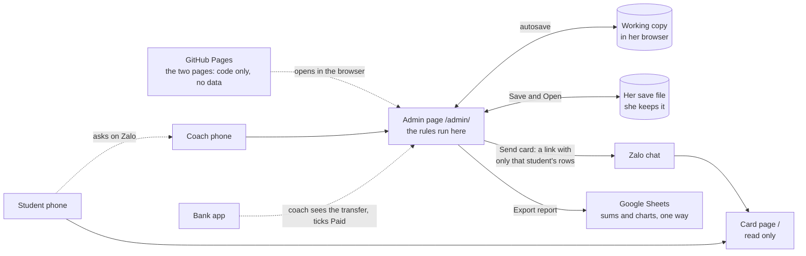
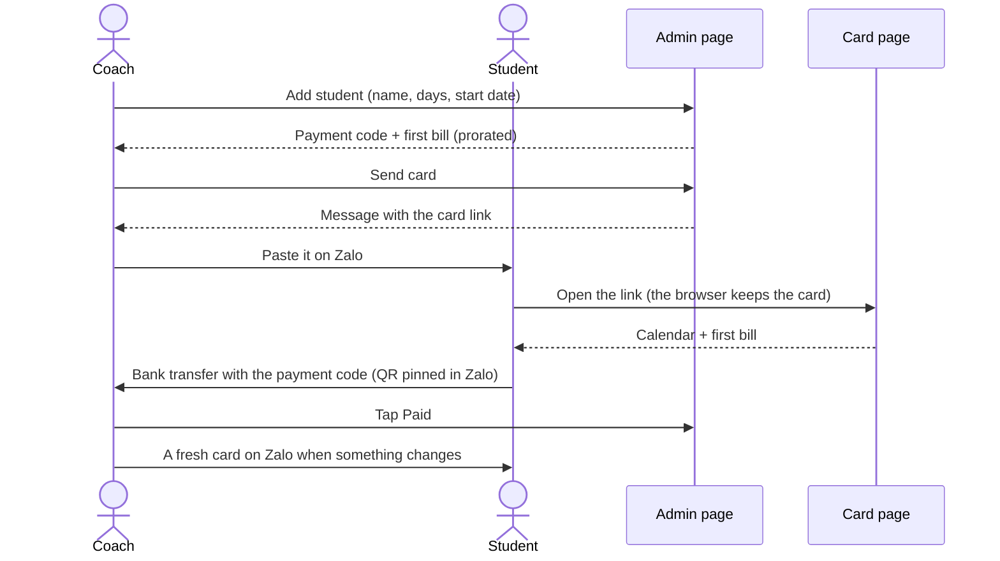
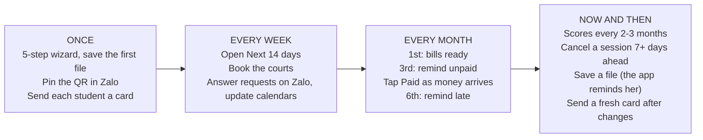
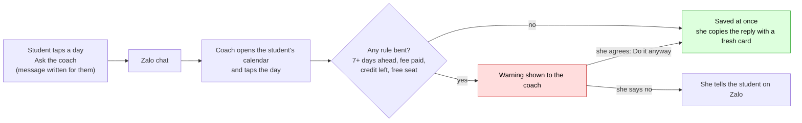
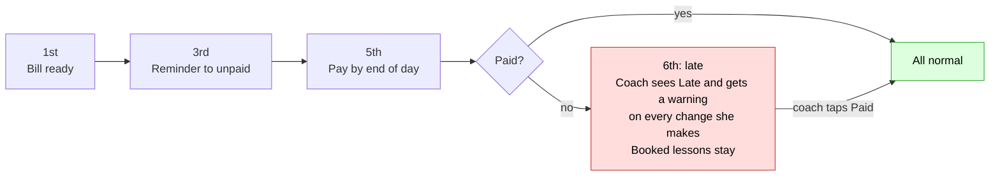

# Birdie Crew: badminton coaching site

Site address: `birdiecrew.github.io` (GitHub Pages, free).

## At a glance
Five pictures. Everything after them is detail.

**1. The parts.** Two static pages and no server. The coach's data is a file she keeps. Students get a card link that holds only their own rows.

**2. A new student joins.**

**3. The coach's routine.**

**4. A student skips or takes a make-up.** The student asks on Zalo. The coach decides and records it.

**5. One month of money.**

## The idea in one line
A free website with no server and no database. The coach runs the class from the **admin page**, and her data is **one save file she keeps** (plus an automatic copy in her browser). Each student gets a **card link** that holds only their own rows (schedule, skill polygon, bills, videos) and that they can only read. Students ask the coach on Zalo to skip or take a make-up, and the coach records it.

The developer builds the bike. The coach brings the gasoline (her data). The developer never sees it.

## What we copied from Project Snowball
Snowball has no payment company. People scan a QR code, put a short code in the transfer note, and the owner checks the bank app, then marks it. We reuse this as is: no accounts, no card fees.

Two differences. Snowball's list of codes is public, but student scores are personal and some students may be kids, so here nothing is public: there is no shared list at all, and each card link carries only that student's own rows. And the code in the bank transfer is a **short public payment code**, separate from the card.

## How it works
- **Website:** plain static pages on GitHub Pages. No server, no database, no script in anyone's account. Two pages: the **card page** (`/`) and the **coach admin page** (`/admin/`). The pages hold code only, never data.
- **The coach's data:** one **save file** (JSON, in a format the app owns). She opens it, works, and saves it. Between saves, the admin page keeps a working copy in her browser, so nothing is lost on a refresh. She never edits the file by hand.
- **Rules:** the rules (credits, the cap of 3, warnings, fees) run in the admin page, in her browser. It is the same code the mockups run, tested by a random-sequence test.
- **Student card:** a link made by the admin page (**Send card**). The data is in the part after `#`, so it never reaches any server. The card is a **snapshot** with an "as of" date. When something changes, the coach sends a fresh one.
- **Who changes lessons:** only the coach, in the admin page, after the student asks her on Zalo. The card cannot change anything.
- **The admin page is the referee.** It checks every rule and warns her. A few rules are **soft** (she can say "Do it anyway"). The impossible ones are **hard** and always refused. See "Skip and make-up".
- **Counting and charts:** a one-way **report** (CSV) that opens in Google Sheets. Changing it there changes nothing in the app.

## The class rules (from the coach's own notice)
These are the real rules of the class. The site must follow them, and every number is a setting the coach can change.

1. **Fee:** paid at the start of each month, **deadline the 5th**.
2. **Timetable:** Monday to Thursday **20:00 to 22:00**. Saturday and Sunday **10:00 to 12:00**. No class on Friday.
3. **Flexible members:** students without a fixed schedule send their planned schedule **the week before**, so the coach can arrange the class and time slots.
4. **Breaks:** for a planned break (for example 2 weeks to 1 month), tell the coach **in advance**, so the coach can arrange the class and **adjust the fee**.
5. **Make-up lessons:** because the class is big, at most **3 make-up lessons per month per person**.
6. **Sudden absence:** if a student reports an absence at the last minute, **no make-up** is arranged.

## How lessons work

### The timetable
The weekly timetable is a setting (weekday, start, end), so nobody has to create lessons one by one. The file only holds a record when something is special: a cancelled day, a day with fewer courts, or extra seats (the "special dates" list).

**Changing the timetable.** The coach can switch a class day on or off and change a time. **A change starts today**: nothing before today moves, so past lessons, bills, paid amounts and credits stay exactly as they were. The file keeps the older timetables, each with the date it stopped. Adding a day (for example Monday) adds sessions from today on, with 16 seats and nobody booked, and fixed students are not moved onto it. Switching a day off asks first, says how many students have it as a regular day, and cancels the make-ups and joins booked on later dates of that day (the credit comes back). Fees do not change when a day is dropped: if a student's days change, she edits the student. The last class day cannot be switched off. A flexible student's bill for the *current* month counts the new sessions from today on, because it is worked out over all sessions.

### Seats and courts (demand-driven)
The venue has **4 courts** and the coach books courts after she knows who is coming. So seats are not fixed by a courts number. Instead:
- A session holds up to **`venue_courts` x `seats_per_court` = 4 x 4 = 16 seats**. The coach can allow 0 to 2 **extra seats** on a session for a squeeze-in.
- The site tells the coach **how many courts to book**: headcount divided by 4, rounded up. It shows this for every session in the admin page.
- Because the coach is warned about changes less than `advance_days` (7) before a lesson, a session's headcount is mostly settled a week ahead. That is when the coach can book courts.
- Regular students are never bumped. If the coach adds people and a session goes over its seats, it shows as "over capacity" for her.
- A student skipping or on a break frees a seat for someone else.
- **Seat numbers are for the coach only.** A card is a snapshot of one student, so it cannot know who else is coming. It shows a day that is not theirs as "not your day, you can ask".
- Capacity check: 16 seats x 6 sessions a week is 96 seat-slots a week at most. So about 48 students attending twice a week is the real ceiling.

### Two kinds of student
- **Fixed schedule** (most students). The coach sets their days (for example Tuesday and Thursday). They are booked every week with no action. When they want to **skip** a lesson or take a **make-up**, they ask the coach on Zalo and she records it.
- **Flexible schedule.** No fixed days. They ask the coach for the sessions they plan to attend, at least `flex_notice_days` before each one, and she adds them. This is the site version of "send me your plan the week before". Seats apply. They have no make-up credits, because there is no fixed lesson to make up.

### Skip and make-up (fixed students), step by step
**The flow:** the student taps a day on their card and then **Ask the coach**. The button writes the message for them (their name, payment code and the date, in Vietnamese or English) and copies it. They paste it into Zalo, or the button opens the coach's Zalo chat (`coach_zalo`). The coach checks her calendar, decides, and records it in the admin page. Then she sends the student a fresh card (the admin page writes the reply, with the new link, ready to paste). There is no request queue: Zalo is the queue.

**How the coach records it.** Students tab, open the student, **Lessons and changes** shows their month. She taps a day and gets only the actions that make sense there: **Skip**, **Undo skip**, **Add make-up**, **Cancel make-up**, **Add to / Remove from session** (flexible students). From the Next 14 days list she can also tap a name in a session, or add a student to it. Moving a make-up is cancel plus add.

**The rules.** The admin page checks them and shows warnings; it never decides for her.
- A skip made at least `advance_days` ahead earns **1 make-up credit**. A student can earn and use at most `max_makeups_per_month` make-ups per calendar month (default 3). A skip beyond that earns no credit.
- The credit must be used on a session **in the same calendar month as the skipped lesson**. Unused credit expires at the end of that month.
- The make-up can be on any session that month with a free seat (before or after the skipped lesson).
- **Undo skip** ("I will attend after all"): the seat comes back, the credit goes away, and a later skip that got no credit (because of the cap of 3) takes the freed one. If that credit was already used for a make-up, the coach must cancel that make-up first. A skip that comes from a planned break is undone by removing the break. Change records are never deleted: they get a cancelled time.

**Soft rules (warning first, then "Do it anyway").** The coach can bend these when she agrees. The change is saved and written in the change log with the rules it bent (for example `notice`, `noCredit`), so there is a record. A plain change leaves no mark.
| Soft rule | Warning she sees |
|---|---|
| Notice | "Less than 7 days before the lesson." A last-minute skip still counts as attended unless she says otherwise. |
| Late fee | "This student's fee is late." |
| Session full | "The session is full. This takes the headcount over the seats." The session shows as over capacity. |
| No credit | "No make-up credit this month." Doing it anyway makes a **courtesy make-up**: no credit used, not counted in the cap of 3. |
| Cap reached | "Already 3 make-ups this month." Same: a courtesy make-up. |
| Break notice | "The break starts in less than 7 days." |

**Hard rules (never possible).** Not one of their lessons, session cancelled, no class that day, they are on a break, already done for that day, a make-up on their own regular day (so nobody is booked twice), a skip whose credit already paid for a make-up (cancel that make-up first), overlapping breaks, a flexible-only action on a fixed student and the other way round.

- **Sudden absence = no make-up.** A student who does not show up gets nothing. A skip she records inside the notice window shows the warning, so the coach knows she is making an exception.
- **Changing a booked make-up** has no monthly limit. The coach is in charge.

### Planned breaks (long vacations)
- A student who will be away for a stretch (a holiday, exams) tells the coach on Zalo (the card has an **Ask the coach to plan a break** button). The coach plans it in the admin page (More, Breaks, **Plan a break**): student, from date, to date. It pauses **all** their weekly lessons for those dates. Soft warning if it starts less than `advance_days` (7) from today.
- A break of **`long_break_days` or more** (default 14 calendar days) is a **long break**. In it the student is off every session, **no make-up credits** are earned, and the **fee is reduced** for the lessons they miss (see "What a student pays"). The form shows the new fee before she saves.
- A shorter break is not a long break. Each skipped lesson is a normal skip, with a make-up credit and the cap of 3.
- The card shows the student their planned breaks (read-only): "A long break lowers your fee. It does not give make-up lessons."
- The coach can remove a break (not while one of its skips has paid for a make-up) and change the worked-out amount.

### When the coach cancels a session
- The coach cancels in the admin page, usually for a public holiday. She follows the **same notice rule**: at least `advance_days` before. If she cancels later, the page warns her and she sorts it out on Zalo. Cancelling a session that is already cancelled is refused, so nobody gets the free credit twice.
- **No refund.** Instead, every affected fixed student gets **1 free make-up credit** ("compensation"). It does not count toward the 3-make-up cap, and it stays valid for `cancel_credit_months` more month(s) (default 1), so a holiday near the end of a month can still be made up. The make-up date still follows the notice rule.
- The announcement goes through her private Zalo channel. The admin page writes the message for her to paste (see "Reminders and messages").

## How the screens talk (all of them)
The screens say as little as possible. The picture, the layout and the dimmed buttons do the explaining.
- **One-word labels.** "Name", "Days", "Start", "Fee". A sentence only for a warning or an error, and only when it applies.
- **No instruction text.** No "tap a day to change it", no "check your bank app, then tap Paid", no hints under fields. Blocked buttons give a reason of about three words.
- **Nothing in green to say "ready".** When all is well the reason line is empty. It keeps its height, so nothing jumps.
- **Positive words.** The card says "Focus: Smash", never "weakest".
- **No "Coach" or "Student" labels.** The logo and the title are enough. The coach's page has the icon bar and the save icon, so the two pages already look different.
- **One word per action.** It is **Save** everywhere (the save icon, the Save file button, "Saved 2 min ago"). There is no second word such as "back up".
- **Icon-only navigation**, like Facebook. The page title is the label, and every icon keeps a name for screen readers and a badge where there is work.
- **Full pages, not pop-ups.** Forms and detail open as a full screen that slides in with a back arrow, like iPhone Settings. A small bottom sheet is kept only for a one-tap action (a day, a confirmation).
- **Toasts only for errors** and for things that are not already visible. No "Saved" after every change.
- **Look:** the screens follow the phone's light or dark setting. A manual switch lives under More.
- **Language:** **Vietnamese is the default** on both pages, because the coach is more comfortable in it. English is one small button on the card and a switch under More on the coach's page.
- **Layout:** one column, up to about 720 px wide. On a laptop the same column is centred and the icon bar moves to the top. Every control is at least 48 px tall (40 px for compact ones), and nothing scrolls sideways, even at 320 px.

## What a student sees (one card, mostly pictures)
The card is **read-only** and is a **snapshot**. The header is one line: the student's name and when the card was made ("Jane · 5 Nov, 14:32"), with one small language button. After 7 days a banner says "Old card. Ask your coach for a new one."

**Two cards on one phone.** A phone keeps one card per student, and **the newest wins**. If the student opens an older link from the chat, the page keeps and shows the newer card and says so. Opening the page without a link shows the newest card. (A brother or sister who opens a card for another student replaces it, so each should keep their own link.)

**Quiet by default.** There is no "Key" button, no counters (make-ups left, credits), and no title above the calendar. A rule is mentioned only when it is about to be broken, for example "No make-up left. The coach may say no."
1. **Calendar:** the month and the grid, nothing else. Regular days are solid, skipped days are crossed out, make-up days have a thick outline, and a day that is not theirs has a plain outline. Tapping a day shows what it is, and where it makes sense one button that is the action itself, with a chat icon: **Skip this lesson / I will attend / Make-up here / Extra lesson here / Add me / Remove me / Move or cancel**. With no make-up credit left (or the monthly limit reached) the make-up becomes **Extra lesson here**, with a line saying why. Tapping the button copies a ready message (name, payment code, date, in the card's language) and opens the coach's Zalo chat when her number is set; otherwise it shows the message to paste. A day inside the notice window says so: "Under 7 days: the coach may say no."
2. **Rows under the calendar:** Skills, Fees, Rules, and Break only when the student has one planned. Each opens a full page.
3. **Skills:** 6 skills (Smash, Net, Footwork, Defense, Serve, Stamina), each scored 1 to 10 by the coach. The polygon prints each number and, next to it, the change since the previous scoring ("Smash 6 +1"). There is no separate table, because it would repeat the polygon. Below it: "Next focus: Smash" and the clip for that skill, when the coach has set a link. The coach scores every 2 to 3 months. No score yet means the row is hidden.
4. **Fees:** this month's amount and status, six month dots, and **Pay** while the bill is unpaid. Pay shows the amount and the short payment code with copy buttons, and says "Pay with the QR in Zalo" (a link cannot carry a picture).
5. **Rules:** the six class rules with the coach's real numbers, and at the end **Ask for a break**, which is how a student asks to plan a break.

There is no welcome pop-up: the page just opens. If the link is cut short, the card says "Link did not open. Ask your coach to send your card again." The page remembers the last card it opened.

## What the coach sees (admin page)
Design rule: **click and click.** The coach manages all student data herself, from her phone, with big buttons, pickers instead of typing, and about 3 taps per job. She never touches the file by hand.

**The frame.** The header is the logo, the class name and one **save icon** (a tick when everything is in a file, a tray when there are changes not yet saved). The bottom bar has five icons: Sessions, Students, Payments, Remind, More, with a badge where there is work. On a laptop the bar sits at the top.

**First run.** A start screen with the logo, one line ("Your data stays on this phone."), one main button **New class**, and two quiet ones: **Open file** and **Sample** (made-up students, clearly marked, cleared with one tap). New class is a 5-step wizard with only a title and fields on each step:
1. **Your class:** tap the days she teaches, check the times, courts and the two fees (all prefilled with her usual numbers).
2. **Students:** paste first names, one per line, from Zalo, notes or a spreadsheet column. Numbers, bullets and repeats are cleaned up, and she sees the count.
3. **Days:** one row of day chips sets everyone at once, then she fixes the few who are different. Each student's row ends with a **Flex** chip.
4. **Paid:** a switch per student, or All / None. She can skip it.
5. **Save file:** the first save, through the phone's share sheet (Files, Zalo, email). Finish stays dimmed until she saves or taps Skip and confirms.

No phone numbers, photos or emails are ever asked for. A class of 20 takes about 5 minutes.

**Every day:**
1. **Next 14 days:** for each session, the headcount, who is coming, who skipped, who is on a make-up, and the **courts to book** (a court icon and a number), with an "over capacity" warning. **Tap a name** to change that student's lesson, or **Add a student** to the session.
2. **Students:** a list with the name and days (no codes on the rows), a search box, and filter chips only when they have something to show. A banner "3 cards to send" appears only when there is something to do. **Add** opens a full page with four fields: **Name**, **Days** (the weekday chips plus **Flex**), **Start**, **Fee** (empty means the usual 800,000 or 1,300,000, shown as the placeholder). Choosing Flex clears the days and choosing a day clears Flex. A student page has **Lessons** (their calendar: tap a day to skip, add a make-up, undo, join or leave, with warnings and **Do it anyway**), **Send card**, the payment code with a copy button, the same four fields, Save, and Pause.
3. **Payments:** the month's list, unpaid students first, with the amount (tap to change it) and one **Paid** button. A status shows only when late or paid. She cannot go to a future month.
4. **Remind:** today's reminder list with a **Copy message** button each (see "Reminders and messages").
5. **More:** five plain rows: **My data**, **Scores**, **Breaks**, **Timetable**, **Settings**, then the language and light/dark switches.
   - **Scores:** pick a student, last scores are prefilled, tap only what changed, Save. A **Videos** button lives here (one link per skill).
   - **Breaks:** the list and **Plan a break**, which shows the new fee before she saves.
   - **Timetable:** class days and times, and a **Cancel a session** button (pick a date, see how many students get a free make-up, copy the announcement). Special dates (extra seats, fewer courts) are below.
   - **Settings:** short labels with no "default" lines: **Class name** first (so a typo in "VM Badminton" can be fixed at any time; every sent card then becomes out of date and appears in cards to send), page picture, rules, seats, money, her Zalo number, the card language, her QR image, and the message texts tucked under **Messages**. One **Reset all** at the bottom.
   - **My data:** a status line (Saved 2 min ago / Not saved), **Save file**, **Open file**, **Export report**, earlier copies on the phone (only when there are some), and **Start over** at the bottom (dimmed until the data is in a file).

**Cards to send.** The Students banner opens a page that lists every card that is new or out of date, each with one **Copy message** button; a card counts as sent when she copies it, and the list keeps its order so rows never jump. A change for one student makes only that student's card out of date. Changing the timetable or the class name makes every card out of date, because every card holds them. **Send card** on a student shows only the language choice, **Copy message**, **Preview** and one short line saying whether anything changed since the last card.

### Making mistakes hard
The screens stop mistakes before they happen, instead of explaining them afterwards.
- **Order is enforced.** In the wizard a step opens only when the steps before it are complete. In Add student, the day chips stay dimmed until there is a name.
- **Dimmed, never hidden.** A button that cannot be used yet stays in place, dimmed, and a reserved line under it says why in a few words ("2 students need days", "Type a name", "Name already used", "Pick days or Flex", "Date out of range"). When all is well that line is empty. Nothing appears or disappears, so the layout does not jump.
- **Numbers cannot run away.** Steppers stop at their limits. Fees move in steps of 50,000 dong. Linked numbers cannot cross: the 2-day fee can never be below the 1-day fee, the buttons just stop. A typed fee is rounded and clamped, with a message.
- **Pick, don't type.** Times come from a list, and the end list offers only times after the start. Dates have a window of a year around today.
- **Names:** at most 20 letters, no repeats (accents ignored), at most 60 students per class.
- **One class day always stays on.** The last day's switch is dimmed.
- **Start over is dimmed** until the data is in a saved file.
- **Big fingers.** Every control is at least 48 px tall (40 px for compact ones), with one size, one set of colours and one wording for the same kind of control everywhere. A narrow phone (320 px) shrinks the calendar's width instead of overflowing.

## Rules and settings
All numbers below are **settings in the Settings screen**, saved in her file, so the coach can change them without touching code. Defaults are shown.

| Rule | Default | Setting name |
|---|---|---|
| The coach is warned when a skip, make-up or break is less than this many **calendar days** before the lesson (weekends count) | 7 | `advance_days` |
| The coach is warned when a flexible student is added less than this many days before the session | 7 | `flex_notice_days` |
| Monthly fee is paid by the end of this day of the month | 5 | `pay_by_day` |
| A new student's first bill is due this many days after their start date (or on the pay-by day, whichever is later) | 3 | `first_bill_days` |
| Make-ups per student per month | 3 | `max_makeups_per_month` |
| A break this many days or longer is a long break | 14 | `long_break_days` |
| Players per court | 4 | `seats_per_court` |
| Courts the venue has. No session can have more | 4 | `venue_courts` |
| Monthly fee, 1 day a week (dong) | 800,000 | `fee_1day` |
| Monthly fee, 2 days a week (dong) | 1,300,000 | `fee_2days` |
| Work out the bill from the lessons studied (mid-month joiners, long breaks). Off = always the full fee and the coach types any change | on | `proration` |
| A paid month later found to be too high becomes a credit on the next bill. Off = the coach handles it by hand | on | `credit_carry` |
| A cancelled-session credit stays valid this many months after the lesson's month | 1 | `cancel_credit_months` |
| Page title in the browser tab and on the card | VM Badminton | `page_title` |
| The coach's Zalo phone number. The students' **Ask the coach** button opens this chat | (empty) | `coach_zalo` |
| Default language on the card | Vietnamese | `default_lang` |
| Time zone | Asia/Ho_Chi_Minh | `timezone` |
| Currency | VND | `currency` |

**Payment (flat monthly fee by days per week, paid like rent):**
- The fee depends on how many days a week the student comes: **800,000 dong for 1 day, 1,300,000 dong for 2 days** (both are settings). A student with 3 or more days pays the 2-day fee, and a flexible student pays the 1-day fee, unless the coach sets their own fee in the Students tab. Paid by bank transfer, with the student's **short payment code** in the note.
- Paid **by the end of the 5th** is on time. Late starts on the 6th. Once the coach marks it paid, the late warning goes away.
- **A new student's first bill** is due on the later of the 5th and `first_bill_days` (3) after their start date. The late warning starts the day after. Example: starts on the 20th, due on the 23rd, late from the 24th. Starts on the 3rd: due on the 6th.
- The coach marks the month as paid in the admin page after checking the bank app. No receipt upload. The app stores only "paid" and the date, not bank details.
- The late warning looks at the **current month's** payment on the day the coach records the change. A skip of a December lesson recorded on 20 November is judged on November.

**What a student pays (proration):** a student pays only for the days they study.
- Bill = monthly fee x (lessons billed ÷ lessons in a full month for their weekly days), rounded to the nearest 1,000 dong. This is a fixed rule, not a setting: it only matters for part months, so a part-month bill is never an odd number.
- **Not billed:** lessons before the student's **start date** (someone who joins mid-month), and lessons inside a **long break**.
- **Still billed:** normal skips, no-shows, and lessons the coach cancelled. Those get a make-up credit instead of a refund.
- Flexible students use the same calculation, with all timetable sessions in the month as the "full month".
- The coach can overwrite any amount in the admin page.
- If a break is planned after the month was already paid, the difference becomes a **credit on the next bill**. Nobody gets cash back.
- Example: a Tuesday and Thursday student pays 1,300,000 dong. November 2026 has 8 such lessons (3, 5, 10, 12, 17, 19, 24, 26). A long break from 17 to 30 November covers 4 of them. Bill = 1,300,000 x 4 ÷ 8 = **650,000 dong**. They had to tell the coach by 10 November.
- Money is Vietnamese dong, shown as whole numbers.

**When a student is late (from the 6th until they pay):**
- Nothing is locked automatically, because students cannot change anything. The card shows a banner with the Pay now button.
- The coach sees the student marked "Late" in the admin page, and gets a **warning on every change** she records for them ("This student's fee is late"). She can do it anyway, case by case.
- Their regular weekly lessons and any make-ups already booked **stay**.
- Days 1 to 5 are a grace period: no warning yet.

**The notice warning:**
- A skip, make-up, join, leave or break less than `advance_days` calendar days before the lesson shows a warning to the coach. She can do it anyway.
- Example with the default of 7 days: today is 10 Nov. A lesson on 17 Nov gives no warning. A lesson on 16 Nov does.
- The warning is also about the make-up date being chosen, not only the skipped lesson.
- The notice window also protects the coach: a session's headcount is mostly final a week ahead, so she can book the courts.

## Access and privacy
**The short version:** there is no server, so there is nothing to hack and nobody to trust with the data. It lives on the coach's phone and in her file. The pages are code only.

**A student can never see another student.**
- A card link holds only **that student's** rows: their name, weekly days, their own lessons, changes, breaks and credits (from last month on), their last two scores, their own payment status for the last six months, the class timetable and rules numbers, cancelled dates, and the videos the coach set. Nothing about anyone else. The coach's phone number, QR and photos are not in it.
- The card page has no code that writes anything. A card link can show a schedule and a bill, but cannot skip, book or cancel anything.
- The data sits after the `#` in the link. The part after `#` is never sent to a server, so it stays out of GitHub's logs. The page also tells the browser not to send a referrer.
- The page remembers the last card in the student's browser, so reopening the address still shows it.
- **No Google login for students.** It would force every student, including kids, to have a Google account. A link does the same job for far less work, and it is the same idea as "anyone with the link" sharing. The only way student A sees student B's card is if B gives A the link.
- **The honest limit: a card cannot be taken back.** Once a link is sent, it works forever, because there is no server to switch it off. What a leaked card shows is small (first name, schedule, scores, paid or not), and it goes stale, which is why the card shows its date.

**The bank code is not private.** The note in a bank transfer is seen by banks, other staff and screenshots. So the **short payment code** (like `VM042`) is used only in the transfer note and means nothing on its own.

**The coach's admin page**
- **No password.** The data is on her device, so there is nothing for a password to protect, and someone who opens `/admin/` on another device sees an empty start screen. The phone's own lock protects the phone. A PIN on the page is a possible later add-on.
- **The admin page makes no network calls.** Its security policy (Content-Security-Policy) forbids connections, so the browser itself blocks any attempt to send data out. There is no analytics and there are no third-party scripts or fonts. She can check it herself: switch on airplane mode and everything still works. (The policy is set in the page's `<meta>` tag, because GitHub Pages does not let us set headers. To be verified in step 2.)
- The file is a plain file. Opening a file from someone else loads their data into her phone, so the app checks the shape and refuses anything that is not a Birdie Crew file.

**Other safety**
- The repo is **public** (free Pages needs it). No student data, names or QR images are ever committed to it. The mockups use made-up names only.
- **Names only.** The app keeps first names or nicknames, and nothing else personal: no phone, email, address or photo. Money is stored as "paid or not" with the amount the rules worked out, not as bank details.
- Dates use one fixed time zone, set in the settings.
- **File integrity:** every save file carries a version number and a fingerprint. If the file was changed outside the app, or damaged, the app says so in plain words and offers the last good copy. This catches mistakes. It is not a security feature.
- **Single device.** The data lives on one device at a time. Using two devices means opening the latest file on the second one, and the newest save wins. The app does not merge.

## Ownership and handover (so the coach can trust it)
**The goal:** the developer can never see the coach's data, and the design makes that true by construction, not by promise. The developer builds the bike. She brings the gasoline.
- **Nothing of hers is on the developer's side.** There is no server, no Sheet, no script, no account to hand over. Her data is a file on her phone. The developer has nothing to see, even if asked.
- **She can check it.** The code is public and small, and anyone she trusts can read it. The admin page cannot make network calls (see above), and she can test it in airplane mode. The page shows its version number in My data.
- **Developing and supporting on fake data.** The sample class (made-up students, and the same file format) is what the developer tests, demos and debugs with. For a real problem, she sends a copy of her file, or the developer adds a **support copy** button later that replaces every name with S1, S2, and so on.
- **Updates reach her at once.** Fixes ship through GitHub Pages, and nothing has to be redeployed in her account. The flip side: whoever controls the page address could change the page later, so the repo history is public, and she can always take a copy (below).
- **File format changes are the app's job.** The file has a version number. A newer app opens an older file and upgrades it. An older page refuses a newer file and says so.

**Two ways to hand it over**
1. **She uses the developer's address** (`birdiecrew.github.io`). The developer keeps it running and fixes it. Simplest for her. It is a licence or small monthly support fee.
2. **She owns a copy.** Because the site is only static pages with no server, the repo can be moved to her GitHub account and served from her own Pages address, with nothing to migrate. Her file works unchanged. This gives her independence if the developer disappears.

**The usual handover for a small project like this**
1. A short written agreement: what is delivered, that the data is hers, and whether she buys the code (way 2) or licenses it (way 1).
2. A handover checklist: this plan as the runbook, one walkthrough session, the first save file made together, and her written sign-off after trying it.
3. Support is separate and agreed up front: a small monthly fee, or paid by the hour. Nothing stops her hiring someone else, because the code and docs are public.

**Personal data.** Some students may be children. Vietnam's personal-data rules (Decree 13/2023, as understood here) probably call for parental consent, and they make the coach the data controller. Keeping only first names, and keeping them on her own device, makes this much smaller, but she should still check it properly. This plan is not legal advice.

## Pictures
- **Page picture:** the picture at the top of the admin page and in the browser tab. The coach changes it in Settings (Choose picture). It is stored as a small square image in her file. **Students see the default shuttlecock picture**, because a card link is too short to carry a picture (open question).
- **Her QR image:** kept in her file and shown to her. A card cannot carry a picture, so she pins the QR once in her Zalo chat. The card's Pay now shows the amount and the payment code with copy buttons.
- **No student photos.** Fewer personal details to keep, and no way to put them in a link. The avatar is the first letter of the name.

## Reminders and messages
The coach talks to her students on a **private Zalo channel**. Zalo's official message service needs a registered business account and costs money, so version 1 does not send messages by itself. Instead:
- The admin page has a **"to remind" list**: on the 3rd, students who have not paid yet (a friendly heads-up), and from the 6th, the late ones. Each row has a **Copy message** button, and she pastes it into Zalo. The message is ready in Vietnamese and English, with the student's name, payment code and amount.
- **Send card** is the same kind of message: a friendly line plus the card link. She sends it to each new student, and again after changes, guided by the **cards to send** banner and list. (Planned: a **Copy reply** button right after she records a request, giving "Done: Thursday 19 skipped. 2 make-ups left. Your new card: link" in one paste.)
- A cancelled session has a **Copy announcement** button the same way.
- **The other direction:** the student's **Ask the coach** button writes the request message in the same style. It is the mirror of her Copy message buttons.
- Message texts live in her settings, so she can reword them.
- **Later, optional:** automatic email reminders. It would need an optional email per student, which we avoid for now.

## Where the data lives: her file, her browser, the cards
There is **no database and no server.** Think of it as a notebook the coach carries. The data lives in three places:

| Place | What it is | Why |
|---|---|---|
| **Working copy** | An automatic copy in her browser, saved after every change. The last few earlier copies are kept too, so she can go back. | So a refresh or a closed tab loses nothing. |
| **Save file** | One JSON file she makes with **Save file** (through the phone's share sheet: Files, Zalo, email) and opens with **Open a file**. | Her real backup, and the way to move to a new phone. The only copy that lives outside the phone. |
| **Student cards** | Links with one student's rows each. | What students see. Made on demand, stored nowhere. |

**Why this is enough:** a class of up to 60 students (a safety limit in the screens, easy to raise) makes a file of well under 200 KB. Opening, working and saving are instant and work offline. There is no latency, no daily limit and no account.

**What is in the file:** settings, timetable, special dates, videos, students (name, type, days, start date, optional own fee, active, payment code), the change log (skip, make-up, join, leave, cancel credit, with the rule-bent mark), breaks, payments (month, amount, paid date, credit carried on), scores, message texts, her QR image and page picture, and a few flags. The file starts with the app name, a version number, the save time and a fingerprint.

**Keeping it safe and tidy**
- **Backup nudge:** the chip at the top right says **Backed up** or **Back up now**. My data says how long ago the last file was, and warns on a first run with no file. Start over is dimmed until the data is in a file.
- **Storage can be lost.** Browsers can clear a site's storage (for example iPhones after about a week of no use for a site not added to the Home Screen, or "clear history"). Adding the page to the Home Screen helps, and the backup file covers the rest. To be tested in step 2.
- **Earlier copies:** the last five working copies can be restored from My data.
- **Edited or damaged file:** refused with a plain message, and the earlier copy is offered.
- **Growth:** once a year she saves the file, exports the report, and the app can start a new year's file with the students carried over (later).
- **Moving later:** storage sits behind a small `load` and `save` layer (a working copy now, a file now). A Google Drive sync, or a small shared store, can be added later without touching the rules or the pages. It would cost a sign-in and a service, which is why it is not in version 1.

**Counting and charts: the report.** Export report makes a CSV with one row per student per month: lessons billed, skipped, make-ups, amount, paid or not, and the paid date. She opens it in Google Sheets to count, sum and draw charts. It is one way: nothing is read back, so she cannot break the file by editing it.

**Options we weighed**

| Option | Verdict |
|---|---|
| The developer hosts a Sheet and a script | Dropped: the developer could see her data, so she must trust a promise. |
| Her own Google account owns everything, developer as editor | Dropped: heavy setup, and the developer loses control of the stack. |
| Her own Sheet plus a small script the developer provides | Dropped: a script inside her account that she may not trust. |
| Google sign-in, the app creates a Sheet in her Drive (no script) | Kept as a later upgrade only if she needs several devices. Costs a Google permission screen, hourly re-login and a Cloud project. |
| **Browser working copy plus a save file (chosen)** | No accounts, no permissions, no backend, easy to hand over. Needs the backup habit. |
| A file only, nothing saved between sessions | Too easy to forget to save. Used as the backup, not as the main store. |
| A small encrypted store the developer runs | Dropped: the developer would run a service, against the no-backend goal. |

**How a student sees their card (options we weighed):** a link that carries the data (chosen), a picture of the card sent in Zalo, a ready-made text reply (planned as the Copy reply button), or a live page that needs a shared place (dropped for now). The cost of the chosen way: students see the last card she sent, not live data.

**Who is in a session:** every active fixed student whose weekly days include that weekday, whose start date has passed, who is not on a break, minus those with a `skip` for that date, plus those with a `makeup` or `join` for that date.

## What could sink this (and what we do about it)
| Risk | What we do |
|---|---|
| **The coach does not want to use it.** This is the biggest risk, and she has not been asked yet. | Step 0: show her the demo and the rules page before building more. The admin page does her daily jobs (courts to book, who paid) so it saves her time, not adds work. |
| Too many requests land on the coach, and each one now also means sending a fresh card. She becomes the bottleneck. (A rough guess for 100 students is 5 to 10 requests a day. Not measured.) | The Ask the coach button writes a complete, standard message, her calendar tools take about 3 taps per request, and **Copy reply** (planned) makes the answer one paste. Step 0 checks the volume with her. |
| **She forgets to back up, or the browser clears its storage, or the phone is lost.** | The chip, the first-run backup step, Start over locked until a file exists, earlier copies, and the Home Screen tip. Test in step 2 how storage behaves on her phone. |
| Students look at an old card, or hold two cards. | The card shows its date and time, and a banner after 7 days. The newest card on a phone always wins, even if an old link is opened later. The coach sees which cards are new or out of date and sends them from one list. If students want live data, we add a shared place later. |
| A timetable change rewrites history (past bills, credits, calendars). | Changes start today and older timetables are kept with the dates they ended, so nothing before today moves. Covered by tests. |
| A leaked card link cannot be taken back. | The card holds only first names and a schedule, and it goes stale. Said honestly in "Access and privacy". |
| The link is cut short or the in-app browser (Zalo) misbehaves. | A clear "this link did not open" message. Test the card in the Zalo browser in step 2. |
| The file format has to change later. | A version number in the file, and the app upgrades old files. |
| The rules feel too complicated. | The class rules screen explains them in plain Vietnamese and English, with the real numbers. |
| The coach burns out entering scores. | Scoring every 2 to 3 months, and the polygon is optional until a score exists. |

## Build order
0. **Show the coach.** One page: the six rules, the demo, and the open questions below. *Done when she says yes and has answered the questions that are hers.* No code.
1. **Mockups reviewed.** Click-through pages with made-up data (`mockups/`): the first-run wizard, the admin page, My data, Send card and the card opened from a link, with the rules running for real. *Done when the developer and the coach have looked at them on a phone.*
2. **Prove the risky parts on real phones.** One afternoon. (a) Save file and Open a file through the share sheet on her phone. (b) Storage survives a week, with and without the page on the Home Screen. (c) A card link opens in the Zalo in-app browser, and compression works there. (d) The security policy really blocks network calls. *Done when all four work on her phone, or we know the fallback.*
3. **The rules and storage as real code, with tests.** Port the rules engine and the storage layer from the mockups. *Done when `node mockups/tests/run-all.js` passes (see "Tests" below) and the screen tests in `mockups/tests/ui-tests.html` pass in a browser.*
4. **Admin page.** Click and click, phone first: the wizard, Next 14 days with courts to book, students, each student's calendar with lesson changes, payments with worked-out amounts, breaks, cancel a session, the reminder list, timetable and seats, settings, My data. *Done when the coach can run a normal week without anything else.*
5. **Card page.** Read-only, Vietnamese first, opened from the link, with the "as of" line and the old-card banner. *Done when it looks right on a phone and in a chat app's built-in browser.*
6. **Send card and Copy reply.** The message with the link after every change. Backup nudges. The report.
7. **Skills.** Scores, the polygon, and videos. (Open question: skills are the most valuable part for keeping students, so this may move earlier.)
8. **Pay now page.** The amount and payment code with copy buttons. Late banner, and the reduced amount after a long break. Later, if she shares the bank and account number, a QR can be made in the browser with the amount and code filled in.

## Tests
Everything below is runnable now against the mockups. `node mockups/tests/run-all.js` runs all the command-line files (about a minute). The screen tests need a browser: serve `mockups/`, open `/tests/ui-tests.html`, and wait for "UI TESTS: N passed".

| File | What it covers |
|---|---|
| `rules.test.js` | Skip, make-up, undo, seats and courts, late fee, cancelled sessions, breaks, flexible students, and the record of every forced change (the step 3 and step 5 lists below) |
| `ask.test.js` | What a student may ask on each kind of day, extra lesson versus make-up, and that a rule is mentioned only when it would be broken |
| `money.test.js` | Fees by days a week, proration, credits on the next bill, due dates, and that every bill is a whole number of thousands |
| `cards.test.js` | What is in a card, link length, damaged links, two cards and which is newer, what the phone keeps, and when the coach's card is out of date |
| `timetable.test.js` | Adding a day (Monday), dropping a day, changing a time: nothing before today moves, sessions, bills, credits, cards and the file |
| `store-test.js` | The save file, hand-edit detection, names pasted from Zalo, the report |
| `i18n.test.js` | No untranslated text, matching placeholders, a message for every Ask button |
| `rules-fuzz.js` | Thousands of random actions checked against rules that must never break (run on 8 seeds) |
| `ui-tests.html` | The screens: Vietnamese by default, icon-only navigation, pages versus sheets, the laptop layout, first-run gating, no layout jumps, limits, the Flex chip and own fee, renaming the class, My data, cards to send, the student card and two cards, big fingers (every control tall enough), no sideways scrolling at 375 and 320 px |

## Test list for step 3
Assume `advance_days` = 7, `max_makeups_per_month` = 3, `pay_by_day` = 5, and the student has paid. The coach records every change. "Warned" means: refused at first with a soft warning, and it succeeds with "Do it anyway" (marked rule bent). "Refused" means a hard refusal that never succeeds.
- Skip a lesson 8 days away: allowed, 1 credit.
- Skip a lesson 7 days away: allowed. 6 days away: warned (notice).
- Use the credit on a session 10 days away in the same month: allowed. Next month: warned (no credit). Doing it anyway makes a courtesy make-up that uses no credit.
- Use a second credit when only one skip was made: warned (no credit), courtesy on override.
- Four skips in a month, all with notice: all four allowed, but only the first three give a credit. The fourth gives none.
- Undo a skip 8 days away: allowed, the credit goes away. 6 days away: warned. Undo a skip whose credit is already used for a make-up: refused until that make-up is cancelled.
- Four skips (the fourth had no credit), then undo one of the first three: the fourth now gets the credit.
- Three make-ups taken: a fourth make-up is warned (cap reached); doing it anyway is a courtesy make-up and does not count toward the cap.
- A make-up on a full session (16 seats taken): warned (full). After the coach sets extra seats to 1: allowed with no warning. Doing it anyway on the full session shows it as over capacity.
- A make-up on the student's own regular day (skipped or not): refused, so a student is never booked twice in one session.
- Remove a short break whose skips already paid for a make-up: refused until that make-up is cancelled.
- The coach cancels a session that is already cancelled: refused, so nobody gets the free credit twice.
- A session with 9 people shows "courts to book: 3". With 8 people: 2.
- The coach sets courts available to 5 on a session: not possible (the venue has 4).
- Move a booked make-up: it is cancel plus add. There is no monthly limit on changes.
- Today is the 5th and the month is not paid: no warning. Today is the 6th and not paid: every change for that student shows a "fee is late" warning.
- A student starting on the 20th: first bill due on the 23rd, late from the 24th. Starting on the 3rd: due on the 6th.
- Coach marks the month paid on the 12th: the late warning disappears at once.
- The coach cancels a lesson: each affected fixed student gets 1 free credit. It does not count toward the cap of 3.
- A cancelled-lesson credit from November can be used in December, but not in January.
- Ask the coach: the copied message contains the student's name, payment code and the date, in the language shown. Inside the notice window the card says "the coach may say no".
- Every change made with "Do it anyway" is stored with a rule-bent mark listing which rules were overridden. A change made without it has none.

## Test list for step 4 (storage, cards and the admin page)
These run in `store-test.js`, `cards.test.js`, `timetable.test.js` and `ui-tests.html`.
- Saving a file and opening it again gives exactly the same data.
- Opening the Payments screen for a month with no records does not make the file look changed (so the Back up now chip does not nag for nothing).
- A file edited by hand is refused ("changed outside the app"). Text that is not JSON, a file from another app, a file with a newer version number, and a file with the right fingerprint but a broken shape are each refused with their own plain message.
- A student's card contains only that student's rows: no other student's name appears anywhere in it.
- The card link is under about 6,000 characters for a normal student, and a cut-short link gives a "this link did not open" screen.
- A card, once opened, draws the same calendar and the same credit counts as the coach sees for that student.
- Pasted names: bullets, numbers and commas are cleaned, repeats are dropped (accents ignored), names over 20 letters are cut and counted, and only the first 60 are used.
- Two cards for one student: the newer one is always the one kept and shown, even when the older link is opened later. Two cards made on the same day still order by the time they were made.
- The coach's card list: a new student is "no card", a change for that student makes only their card out of date, time passing alone does not, and sending clears it.
- Adding Monday to a Tuesday and Thursday class: no fixed student's lessons, bills or paid amounts change, past months of a flexible student do not move, every card becomes out of date, an old card still draws its student correctly, and the file keeps the history.
- The report is a plain CSV with one row per student per month, and opens in a spreadsheet.
- Wizard: step 3 stays locked until step 2 has a name, Next stays dimmed with its reason, the 2-day fee cannot go under the 1-day fee, the last class day cannot be switched off, the end-time list only has times after the start, and Finish stays dimmed until the file is saved or skipped on purpose.
- Add student: Save stays dimmed with a reason for each of: no name, a name already in the class, no day chosen, a date more than a year away. A class of 60 cannot take another.
- Start over is dimmed while there are changes that are not in a file.
- The admin page shows courts to book for the next 14 days and flags a session over 16 people.
- A Tuesday and Thursday student starting on 17 November (4 of 8 lessons), fee 1,300,000: bill is 650,000.
- Cancelling a session 8 days away: no warning. 5 days away: the page warns about the notice rule.
- On the 3rd the reminder list shows unpaid students. On the 6th it shows them as late. Copy message puts the text on the clipboard.

## Test list for step 5 (flexible students and breaks)
- The coach adds a flexible student to a session 7 days away: allowed. 6 days away: warned (notice).
- The coach removes a flexible student from a session: no credit is given.
- A 14-day break starting 7 days from now: accepted, and the sessions in it show as "on break" with no credits earned.
- A 10-day break: treated as normal skips, with the make-up cap.
- A break starting 3 days from now: warned. Doing it anyway saves it.
- The bill is worked out by itself: 8 lessons in the month, 4 inside a long break, fee 1,300,000 gives 650,000. The coach overwrites it to 600,000: Pay now shows 600,000.
- A break planned after the month is already paid: the difference shows as a credit on the next bill.

## Open questions
Each has a current guess in brackets, so nothing blocks the start. "Coach" means it is hers to answer. They are ordered by how much they could change the design.

**Needs the coach (step 0)**
0. **Coach-only changes (decided by the owner, to confirm with her):** students ask on Zalo and she records every skip, make-up and break. How many requests a day is that for her? Does the Ask the coach button fit how her students already write to her? (Applied: yes, with soft warnings so she can say yes to exceptions. A self-service mode for simple cases can be added later if the volume is too high.)
1. **Is "the last card she sent" enough for students?** Or do they need a page that is always up to date? (Guess: enough. If not, a shared place is added later and the cost is a sign-in or a small service.)
2. **Does she use one device or two?** (Guess: her phone. Two devices means moving the file between them, or the Drive upgrade.)
3. **Is the extra step per request fine?** After recording a change she copies the reply with the fresh card. (The cards-to-send list is built. A one-tap **Copy reply** right after each change is planned.)
4. **Does she agree with the fee rule?** A student pays only for the days they study (mid-month joiners and long breaks), rounded to the nearest 1,000 dong, with a credit on the next bill instead of a refund. (**Applied:** yes. It is flexible: `proration` and `credit_carry` in the settings.)
5. **Flexible students:** is the rule "each session at least 7 days ahead", or "the whole week's plan sent during the week before"? And do they pay the same fee? (Each session at least 7 days ahead, with a fee set per student.)
6. **Cancelled sessions:** is the make-up credit outside the cap of 3, and may it be used one extra month? (Yes to both.)
7. **Reminders:** is copy-and-paste into her Zalo channel fine for version 1? (Copy-and-paste now.)
8. **Typical headcount per session and how many lessons a week each student takes.** (Unknown. The admin page will show real numbers once it runs.)

**Needs you**
9. **Skills first?** Skills are the most valuable part for keeping students and finding new ones. Should scores and the polygon come before payments and breaks? (Guess: build the order above, but keep skills small and early.)
10. **A picture on the card.** Should students see her page picture? A card link is too short for one. (Guess: no, default shuttlecock. Alternative: a very small picture inside the link.)
11. **The coach's QR image.** She pins it in Zalo, and keeps a copy in her file. Is that fine, or should the card show it? (Guess: pinned in Zalo.)
12. **Hand-over model:** her own copy, or the developer's address with a support fee? (Guess: the developer's address first.)

**Technical, answered by building (step 2)**
13. **Do the share sheet, file picker and storage work as expected on her phone, with and without the Home Screen?**
14. **Does the card link open inside the Zalo in-app browser, and does compression work there?** (A plain fallback is built in.)
15. **Does a security policy in the page's `<meta>` tag really block network calls on GitHub Pages?**
16. **A Google Drive sync or a shared place** if one device or live cards turn out not to be enough. (Not in version 1.)

## Decided
- Two static pages on one address: the card page and the coach admin page. **No server, no database, no script in anyone's account.**
- The coach's data is a **save file she keeps**, with an automatic working copy in her browser. The file is in the app's own format (JSON with a version and a fingerprint). She never edits it by hand.
- The developer never sees her data, by construction. The developer builds the bike, she brings the gasoline. The developer tests on a sample class of made-up students.
- The rules run in the admin page and are tested by a random-sequence test. They are the same code in the mockups and the real site.
- Students get a **card link** made by the admin page, holding only their own rows. It is read-only and a snapshot, with an "as of" date. No Google login for students.
- No admin password: the data is on her device. The admin page cannot make network calls.
- The coach keeps **names only**: no phone, email, address or student photos.
- The bank-transfer code is a short public payment code (like `VM042`).
- Counting and charts come from a one-way **report** that opens in Google Sheets.
- The first run is a 5-step wizard with gated steps. Buttons that cannot be used yet stay in place, dimmed, with a reason line, so the layout never jumps. Every control is at least 48 px tall.
- Click and click: the coach manages all student data herself in the admin page, mostly on her phone.
- Everything is called Birdie Crew (repo, plan, code). The page title shown to students is **VM Badminton**, set by the `page_title` setting.
- Money is Vietnamese dong. Time zone is Vietnam (`Asia/Ho_Chi_Minh`).
- Class timetable: Monday to Thursday 20:00 to 22:00, Saturday and Sunday 10:00 to 12:00.
- The venue has 4 courts. A session holds up to 16 seats plus 0 to 2 extra. The site tells the coach how many courts to book.
- Flat monthly fee, paid by the end of the 5th (setting). Fees by days per week: 800,000 dong for 1 day, 1,300,000 for 2. Part-month bills round to the nearest 1,000 dong (a fixed rule).
- A new student's first bill is due 3 days after their start date, or on the 5th if that is later (setting `first_bill_days`).
- A student pays only for the days they study. A mid-month joiner is prorated. A long break reduces the fee. No cash refunds: a credit goes on the next bill. All of it can be switched off or changed in the settings (`proration`, `credit_carry`).
- Fixed weekly schedule per student, or flexible students who pick sessions in advance.
- **Only the coach changes lessons.** Students ask on Zalo (the card's Ask the coach button writes the message) and she records it. The card cannot change anything.
- Skip with notice earns a make-up credit, used in the same month.
- At most 3 make-ups per student per month (setting). More skips are allowed but give no credit.
- Sudden absence, or a skip inside the notice window, gets no make-up.
- A long break is 14 days or more, announced at least 7 days ahead. It gives a lower fee and no make-up credits.
- The coach cancels sessions (usually public holidays) with the same notice rule. No refund: each affected student gets a free make-up credit.
- 7 calendar days notice, weekends included, as a setting.
- Reminders, announcements and cards are copy-and-paste messages for the coach's private Zalo channel. Automatic email is a later option.
- Group classes, 4 players per court.
- Existing bookings stay when a student is late. The coach gets a warning when she changes a late student's lessons, and decides case by case.
- Rules are soft or hard. Soft rules (notice, late fee, full session, no credit, cap of 3, break notice) warn the coach and she can do it anyway; the change is marked rule bent. Hard rules (impossible or double-booking changes) are always refused. A make-up with no credit is a courtesy make-up.
- The coach scores skills every 2 to 3 months. The polygon compares with the previous scoring.
- Both languages (Vietnamese by default, and English), with a toggle.
- Go ahead without waiting for the coach's yes: the mockups cost her nothing, and the step 2 phone test comes before the big build.
- A timetable change starts today and never rewrites the past. The file keeps the older timetables.
- A phone keeps one card per student, the newest wins, and the card shows the day and time it was made. The coach sees which cards are new or out of date.
- The card is quiet: no Key button and no counters. A rule is shown only when it is about to be broken, and with no credit the ask becomes an extra lesson.
- Screens use as few words as possible (see "How the screens talk"). One word per action: Save. Icon-only navigation. Full pages for forms and detail, small sheets only for one-tap things. No toasts for ordinary saves.
- **Vietnamese is the default language** on both pages. The screens follow the phone's light or dark setting.
- A student's schedule is either fixed days or **Flex** (no fixed days). In the form, Flex is one chip at the end of the days row. A student can have their own monthly fee, which overrides the usual tiers.
- The class name (the page title) is editable in Settings, like a student's name.
- The page is one column on every screen. On a laptop it is centred and the icon bar moves to the top.
- No receipt upload.

## Status so far (2026-11-06)
Done:
- Name chosen: **Birdie Crew**, at `birdiecrew.github.io`.
- GitHub account `birdiecrew` and repo `birdiecrew/birdiecrew.github.io` created. The repo is **public**. No student data lives in the repo.
- `main` is protected: changes go through a pull request, and force pushes are blocked.
- PR #1 merged. GitHub Pages is on for `main` and the build status is "built". The placeholder page is live.
- PR #2 merged: the plan became a build-ready spec.
- PR #3 open: the class's real notice applied.
- The coach's answers applied: fee proration, long breaks, cancelled sessions, Zalo reminders, her own QR, dong and Vietnam time, and the VM Badminton page title.
- Click-through HTML mockups of both pages (`mockups/`) with the rules running for real, a neutral palette with green and red meaning only done and wrong, and a random-sequence test of the rules (`mockups/tests/rules-fuzz.js`).
- Changed to coach-only lesson changes, with soft and hard rules and fee tiers by days per week.
- **Changed to the file model (this change):** no server and no Google. Mockups now have the first-run wizard, autosave plus a save file, My data, Export report, Send card, and a card page that opens from a link. A storage test (`mockups/tests/store-test.js`) covers the file, the card and name pasting. Admin password, student keys, student photos and seat numbers on the card are gone. This plan is rewritten to match.
- Student card made quiet (no Key, no counters, extra lesson when there is no credit), newest card wins on a phone, the coach sees cards to send, and timetable changes start today. A full test suite (about 140 scenario checks, the random-sequence test on 8 seeds, and 33 screen tests) was added. Writing the tests found and fixed: a card opened from an old link replaced a newer one, a timetable change rewrote past bills and credits, forced changes were not recorded in the log, the court limit was only enforced on screen, and a few tap targets were too small.
- **Simplified every screen** (this change): shorter labels, no instruction text, icon-only navigation, full-page forms that slide in, one language button on the card, Vietnamese default, Flex chip, positive "Focus" wording, the polygon carries the change since last time, and a laptop layout. About 150 command-line checks and 53 screen tests cover it.
- Git push from this computer works over SSH.

Next:
1. The developer reviews the mockups on a phone.
2. Step 0: show the coach and get her answers (especially open questions 0 to 3).
3. Step 2: the phone test (share sheet, storage, Zalo browser, security policy).
4. Merge the open plan PR.

Working notes:
- Commits use `birdiecrew <lewisozera@gmail.com>`.
- This repo pushes with its own SSH key, set in the local git config (not stored in the repo), so it does not use the key of any other GitHub account on the same computer.
- `gh` may be signed in as another account. For this repo, run it with `GH_TOKEN="$(gh auth token --user birdiecrew)"`.
- The mockup preview server (`.claude/serve.py`, port 8765) is local only and not committed.
